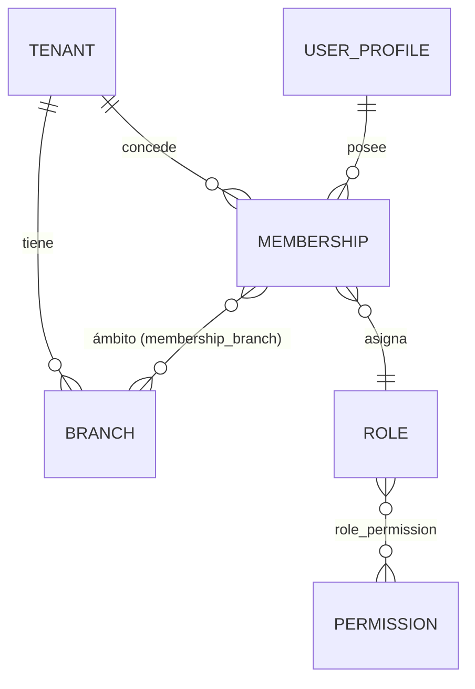
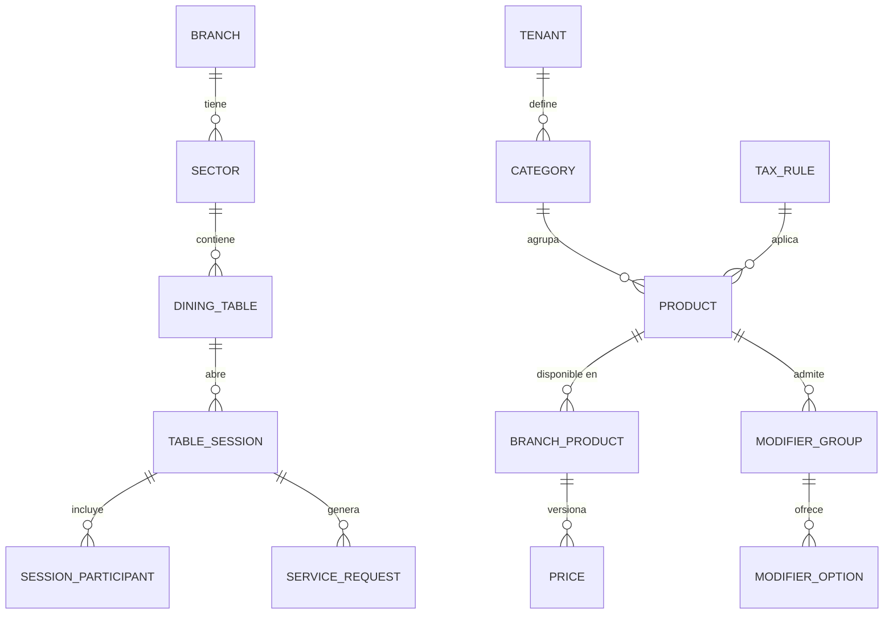
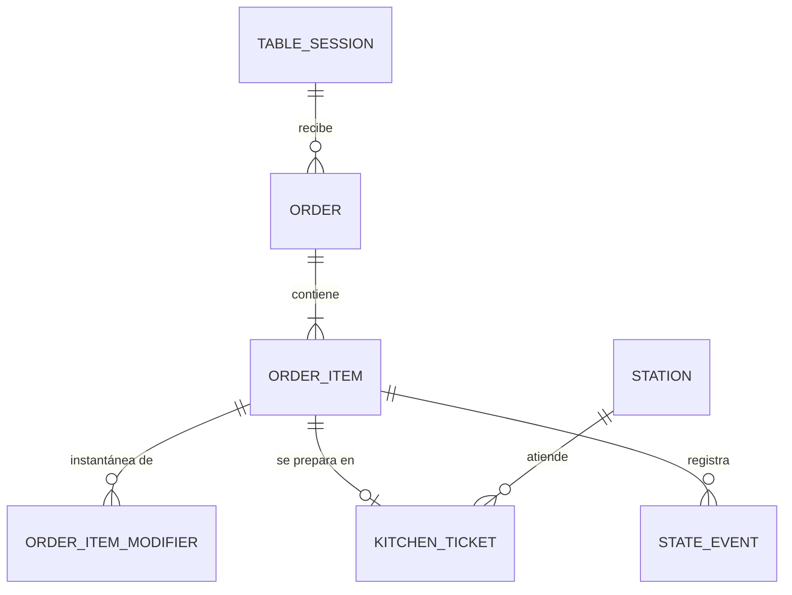
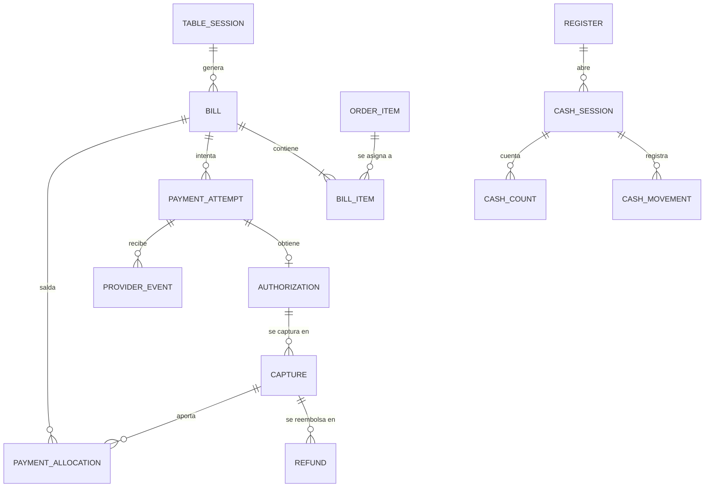
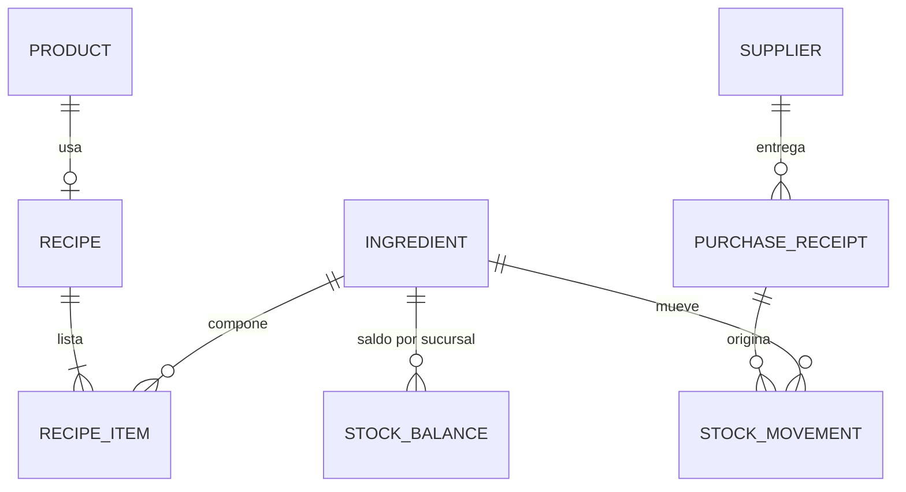

# Modelo de datos — ERD y diccionario

Estado: **«Organización» implementado en la Fase 1** (`dataconnect/schema/schema.gql`); **«Salón», «Carta» y el resumen de pedido, en la Fase 2** (`salon.gql`, `carta.gql`, `pedido.gql`, `control.gql`). El resto sigue siendo el diseño lógico de la Fase 0 y se fija al escribir el esquema en su fase.

**Implementado (Fase 4, bloque 1, 2026-11-18), con sus diferencias respecto al borrador** (`cuenta.gql` y `caja.gql`):

- **Cuenta:** `Bill`, una por sesión de mesa (`sessionId` único), con `version` para que dos cajeros no cobren ni cierren a la vez (caso 9). **No guarda totales mientras está abierta:** sus líneas son las del pedido (`OrderItem`, con su instantánea) que no están canceladas, y el total se calcula en el servidor (`packages/core`, bloque 2); al saldarla guarda `settledTotalMinor`. **Sin `BillItem`:** la línea de la cuenta es la propia `OrderItem`.
- **Preautorización:** `PaymentAuthorization`, una por resumen autorizado (`quoteId` único), porque cada pedido tiene su propia preautorización (D-04) y cada persona paga lo suyo (D-06). Reúne el `Authorization` del borrador y lo capturado (`capturedMinor`); estados `AUTHORIZED`, `CAPTURED`, `VOIDED` y `EXPIRED`.
- **Intento ante la pasarela:** `PaymentOperation` reúne `PaymentAttempt` e `IdempotencyRecord`: una fila por llamada (autorizar, capturar, liberar, reembolsar o cobrar), guardada antes de llamar, con su `idempotencyKey` única, que es la misma que recibe la pasarela. Estados `CREATED`, `PROCESSING`, `SUCCEEDED`, `FAILED` y `UNKNOWN` (casos 3 y 7).
- **Bloque 3A (ADR-0012):** `Branch.orderApproval` (`DIRECT` o `WAITER_APPROVAL`, D-32); `Order.approval` (`NOT_REQUIRED`, `PENDING`, `APPROVED`, `REJECTED`, `WITHDRAWN`) con `approvalRequestedAt`, `approvalDecidedAt`, `approvalDecidedBy` y `rejectionReason`; el resumen suma el estado `CONFIRMED`. Las tablas y columnas de la preautorización quedan sin uso; no se borra nada.
- **Bloque 3:** `PaymentOperation` suma `quoteId` (solo en AUTHORIZE) para que la conciliación encuentre el resumen de una autorización cuya respuesta se perdió.
- **Pago:** `BillPayment` es lo que salda la cuenta: método (`CARD_CAPTURE`, `CARD_CHARGE` o `CASH`), estado, propina aparte del consumo (`tipMinor`, D-05), lo recibido y el cambio en efectivo, y la caja que lo recibió. Su `idempotencyKey` es única por cuenta. La **captura** del borrador es un pago `CARD_CAPTURE` con su `PaymentOperation`, sin tabla propia.
- **Asignación:** `PaymentAllocation` asigna parte de una línea a un pago (única por pago y línea), en lugar de asignar por origen. Así se divide la cuenta y una línea no se cobra dos veces.
- **Reembolso:** `Refund` cuelga del pago (no de la captura), con motivo, estado y clave de idempotencia única por pago.
- **Avisos y tareas:** `ProviderEvent` guarda la huella del cuerpo, no el cuerpo, y es único por proveedor e id externo (caso 8); `tenantId` queda vacío hasta relacionarlo. `OutboxEvent` guarda las tareas que deben terminarse aunque fallen la primera vez.
- **Caja:** `Register` (nombre único por sucursal), `CashSession` con `openRegisterId` único (una sola abierta por caja, el mismo recurso que `openTableId`), `CashMovement` (entrada, salida, venta o reembolso, siempre positivo) y `CashCount` (uno por turno). El bloque 5 suma columnas (ver §7).
- **Invariantes que comprueba el backend en la misma transacción**, porque SQL Connect no ofrece `CHECK` entre filas: lo capturado no supera lo autorizado, lo asignado a una línea no supera su importe y los reembolsos no superan lo pagado.
- Verificado en el emulador (`dataconnect/tests/capacidades-fase-4.int.test.ts`, 17 pruebas): unicidades, FK compuestas entre empresas y sucursales, y el cambio condicionado por versión de la cuenta.

**Implementado (Fase 3, bloque 1, 2026-11-16), con sus diferencias respecto al borrador:**

- **Estaciones** (`cocina.gql`): `Station` por sucursal. La estación predeterminada se marca con `defaultForBranchId` único (vale el id de la sucursal en la predeterminada y `null` en las demás), el mismo recurso que `openTableId`, porque SQL Connect no ofrece índices únicos parciales. `ProductBranch.station` (opcional) asigna cada producto de la carta de la sucursal; la FK compuesta incluye `branchId`, así que no admite una estación de otra sucursal.
- **Pedido** (`pedido.gql`): `Order` (tabla `customer_order`, porque `order` es palabra reservada de SQL) referencia la sesión, a quien pidió y su resumen; `quoteId` único garantiza un pedido por resumen (caso 3) y reemplaza el `idempotency_key` del borrador. No guarda importes ni estado: los importes son los del resumen y el estado se deriva de las líneas (`packages/core`, `order-status.ts`). `sentToKitchenAt` (bloque 2) marca cuándo llegó a cocina: el backend guarda el pedido con sus líneas y lo envía después con `ServerSendOrderToKitchen`, que comprueba la autorización (D-04). Mientras está vacío, nadie ve el pedido.
- **Líneas:** `OrderItem` guarda la instantánea de la línea del resumen (nombre, alérgenos declarados, cantidad, importes y nota), la estación fijada al enviar, el estado y `version`. En lugar de `KitchenTicket` y `StateEvent`, la línea lleva la estación y una marca de tiempo por estado (`startedAt`, `readyAt`, `pickedUpAt`, `deliveredAt`, `cancelledAt`): como ningún estado se repite ni retrocede (D-26), son su historial completo, y quién hizo cada cambio queda en `AuditEvent`. Cancelar guarda el motivo y si fue merma (`wasted`). `OrderItemModifier` guarda cada opción elegida con su nombre e importe.
- **Solicitudes:** `ServiceRequest` (`salon.gql`), con tipo (`CALL_WAITER`, `REQUEST_BILL`) y estado (`PENDING`, `ATTENDED`). `pendingKey` único (`<sesión>:<tipo>` mientras está pendiente) deja una sola solicitud pendiente de cada tipo por mesa.
- **Resumen:** `OrderQuote` suma `consentTextVersion` y `consentedAt` (RF-PA-02), `authorizedAt` y el estado `RELEASE_PENDING` (autorizado pero no enviado: la retención queda para liberar en la Fase 4).
- Verificado en el emulador (`dataconnect/tests/capacidades-fase-3.int.test.ts`): estación predeterminada única, estaciones y opciones de otra sucursal o empresa rechazadas, un pedido por resumen, y un cambio condicionado por estado y versión que gana una sola vez.

**Implementado (Fase 2, bloque 1, 2026-11-14), con sus diferencias respecto al borrador:**

- **Salón:** `Sector`, `DiningTable` (`qrPublicId` aleatorio y único) y `TableSession`. El borrador preveía un índice único parcial para garantizar una sola sesión abierta por mesa; SQL Connect no lo ofrece, así que se usa `openTableId` único, que vale el id de la mesa mientras está abierta y `null` al cerrarla. Verificado: el segundo intento de abrir la misma mesa falla por unicidad. `SessionParticipant` guarda `authUid` (sesión anónima) y `expiresAt` en lugar de un token: no hay credencial propia que guardar (ADR-0011).
- **Carta:** `TaxRule` (siempre incluido, D-01b; sin campo `inclusive`), `Category`, `Product` (alérgenos declarados como lista), `ModifierGroup`, `ModifierOption` (precio adicional por empresa), `ProductBranch` (disponibilidad y horario con `daysMask` y minutos locales) y `Price` (historial). `ProductBranch.currentPrice` apunta a la versión vigente para que la carta se lea en una consulta; se actualiza en la misma transacción que inserta el precio nuevo.
- **Pedido:** `OrderQuote` y `OrderQuoteLine` (resumen verificable con instantáneas), escritos solo por el backend. `IdempotencyRecord` se sustituye en esta fase por la unicidad `(participantId, idempotencyKey)` del resumen más su huella SHA-256 (`fingerprint`, bloque 3), que detecta una clave reutilizada con otro contenido y servirá a la Fase 3 para verificar el resumen al enviarlo a cocina. Las opciones elegidas se guardan como instantáneas JSON con nombre e importe.
- **Control (bloque 3):** `RateLimitHit` (`control.gql`): una fila por solicitud admitida a un límite del backend, con índice `(scope, subject, at)`. Solo la usa el backend; la purga de filas antiguas queda pendiente.
- Todas las relaciones usan FK compuestas con `tenantId` y, en lo operativo, `branchId`.

**Implementado (Fase 1):** `Tenant` (con `status` ACTIVE/SUSPENDED), `Branch`, `UserProfile` (solo `displayName`; sin correo, por minimización), `Role`, `Permission`, `RolePermission`, `Membership`, `MembershipBranch` (FK compuestas hacia `Membership` y `Branch` con `tenantId`) y `AuditEvent` (operación, recurso, actor y motivo; sin `before`/`after` todavía). Diferencias con el borrador: los roles son **solo de sistema** (clave `code`, sin `tenant_id`) hasta que haga falta personalizarlos; `version` en `Membership` se aplaza hasta que haya edición concurrente real; las empresas, sucursales y el catálogo de roles se crean por aprovisionamiento en el servidor, nunca desde la app.

## 1. Convenciones comunes

| Regla | Aplicación |
|---|---|
| Identificadores | `id uuid` no predecible en recursos expuestos; aun así se comprueban permisos |
| Ámbito | Toda entidad de negocio lleva `tenant_id`; las operativas, también `branch_id` |
| Integridad entre empresas | Claves foráneas **compuestas** `(tenant_id, id)` o `(tenant_id, branch_id, id)` para impedir vínculos cruzados |
| Unicidad | Restricciones únicas incluyen el ámbito (p. ej. `UNIQUE (tenant_id, branch_id, code)`) |
| Dinero | `*_minor bigint` + `currency char(3)` (ADR-0005) |
| Tiempo | `timestamptz` asignado por el servidor (UTC) |
| Concurrencia | `version integer` en entidades editables concurrentemente (cuenta, mesa, sesión, stock) |
| Auditoría | `created_at`, `created_by`, `updated_at`, `updated_by` |
| Borrado | Ventas, cobros y movimientos nunca se borran; catálogo se archiva (`archived_at`) |
| Índices | Sobre consultas reales: `(tenant_id, branch_id, status, created_at)` como patrón base |

## 2. ERD por grupos

### Organización

### Salón y carta

### Operación

### Cuenta, pagos y caja

### Inventario y control

`AUDIT_EVENT`, `IDEMPOTENCY_RECORD` y `OUTBOX_EVENT` son transversales y referencian cualquier recurso por `(resource_type, resource_id)`.

## 3. Diccionario (campos clave)

Se omiten las columnas comunes de la sección 1 salvo cuando aportan.

### Organización

| Entidad | Campos clave | Restricciones / notas |
|---|---|---|
| Tenant | `id`, `name`, `status`, `default_currency`, `default_timezone` | Límite de aislamiento |
| Branch | `tenant_id`, `id`, `name`, `currency`, `timezone`, `prices_include_tax`, `rounding_rule`, `status` | Parámetros por sucursal (D-01) |
| UserProfile | `id` (= uid de Firebase Auth), `display_name`, `email` | Datos personales mínimos (D-10) |
| Membership | `tenant_id`, `user_id`, `role_id`, `status`, `revoked_at`, `version` | `UNIQUE (tenant_id, user_id)`; revocación efectiva en servidor |
| MembershipBranch | `tenant_id`, `membership_id`, `branch_id` | Ámbito de sucursales asignadas |
| Role | `tenant_id` (nulo para roles de sistema), `code`, `rank` | `rank` impide invitar a un rol superior |
| Permission | `code` (p. ej. `bill.refund`) | Catálogo fijo versionado en código |

### Salón

| Entidad | Campos clave | Restricciones / notas |
|---|---|---|
| Sector | `tenant_id`, `branch_id`, `name`, `sort` | |
| DiningTable | `tenant_id`, `branch_id`, `sector_id`, `code`, `seats`, `qr_public_id`, `version` | `UNIQUE (tenant_id, branch_id, code)` |
| TableSession | `tenant_id`, `branch_id`, `table_id`, `status`, `opened_at`, `closed_at`, `version` | Máximo una sesión abierta por mesa (índice único parcial) |
| SessionParticipant | `session_id`, `kind` (cliente/mesero), `auth_uid`, `token_hash`, `expires_at` | Credencial de alcance reducido; nunca se guarda el token en claro |
| ServiceRequest | `session_id`, `type`, `status`, `handled_by` | |

### Carta

| Entidad | Campos clave | Restricciones / notas |
|---|---|---|
| Category | `tenant_id`, `name`, `sort`, `archived_at` | |
| Product | `tenant_id`, `category_id`, `name`, `description`, `allergens_declared`, `tax_rule_id`, `archived_at` | Alérgenos como información declarada |
| BranchProduct | `tenant_id`, `branch_id`, `product_id`, `available`, `schedule` | Disponibilidad por sucursal |
| Price | `branch_product_id`, `amount_minor`, `currency`, `valid_from`, `version` | Historial; el pedido referencia la versión |
| ModifierGroup | `product_id`, `min`, `max`, `required` | `CHECK (min <= max)` |
| ModifierOption | `group_id`, `name`, `price_delta_minor` | |
| TaxRule | `tenant_id`, `code`, `rate_bp` (puntos básicos), `inclusive` | Depende de D-01 |

### Operación

| Entidad | Campos clave | Restricciones / notas |
|---|---|---|
| Order | `tenant_id`, `branch_id`, `session_id`, `status` (derivado), `idempotency_key`, `submitted_by`, `submitted_at` | `UNIQUE (tenant_id, idempotency_key)` |
| OrderItem | `order_id`, `product_name_snapshot`, `unit_price_minor`, `quantity`, `tax_snapshot`, `station_id`, `status`, `version` | `CHECK (quantity > 0)`; instantánea inmutable |
| OrderItemModifier | `order_item_id`, `name_snapshot`, `price_delta_minor` | Instantánea |
| Station | `tenant_id`, `branch_id`, `name` | |
| KitchenTicket | `order_item_id`, `station_id`, `priority` | |
| StateEvent | `resource_type`, `resource_id`, `from`, `to`, `actor`, `reason`, `at` | Historial de transiciones |

### Cuenta, pagos y caja

| Entidad | Campos clave | Restricciones / notas |
|---|---|---|
| Bill | `tenant_id`, `branch_id`, `session_id`, `currency`, `status`, `subtotal_minor`, `tax_minor`, `discount_minor`, `tip_minor`, `total_minor`, `version` | Moneda única por cuenta |
| BillItem | `bill_id`, `order_item_id`, `amount_minor` | Una línea no se asigna dos veces por encima de su importe |
| PaymentAttempt | `tenant_id`, `bill_id`, `idempotency_key`, `amount_minor`, `currency`, `status`, `consent_text_version` | Ver `state-machines.md` |
| Authorization | `attempt_id`, `provider_ref`, `authorized_minor`, `expires_at` | |
| Capture | `authorization_id`, `provider_ref`, `amount_minor`, `status` | Σ capturas ≤ autorizado vigente |
| Refund | `capture_id`, `provider_ref`, `amount_minor`, `status`, `reason`, `requested_by` | Σ reembolsos confirmados ≤ capturado |
| PaymentAllocation | `bill_id`, `source` (captura/efectivo/otro), `amount_minor` | Σ asignaciones = total exacto al cerrar |
| ProviderEvent | `provider`, `external_event_id`, `payload_hash`, `received_at`, `processed_at` | `UNIQUE (provider, external_event_id)` (deduplicación) |
| Register | `tenant_id`, `branch_id`, `name` | |
| CashSession | `register_id`, `opened_by`, `opening_float_minor`, `status`, `closed_at` | Una abierta por caja |
| CashMovement | `cash_session_id`, `kind`, `amount_minor`, `reason` | |
| CashCount | `cash_session_id`, `expected_minor`, `counted_minor`, `difference_minor`, `reason` | |

### Inventario

| Entidad | Campos clave | Restricciones / notas |
|---|---|---|
| Ingredient | `tenant_id`, `name`, `base_unit` | |
| Recipe / RecipeItem | `product_id`; `ingredient_id`, `quantity`, `unit` | Conversiones de unidad definidas |
| StockMovement | `tenant_id`, `branch_id`, `ingredient_id`, `kind`, `quantity`, `source_ref` | `UNIQUE (source_ref, ingredient_id, kind)` evita doble descuento |
| StockBalance | `tenant_id`, `branch_id`, `ingredient_id`, `quantity`, `version` | Política de stock negativo pendiente |
| Supplier / PurchaseReceipt | `tenant_id`; `supplier_id`, `branch_id`, `received_at` | |

### Control

| Entidad | Campos clave | Restricciones / notas |
|---|---|---|
| AuditEvent | `tenant_id`, `actor`, `resource_type`, `resource_id`, `operation`, `reason`, `before`, `after`, `at`, `correlation_id` | Solo inserción para roles de negocio |
| IdempotencyRecord | `tenant_id`, `key`, `operation`, `request_hash`, `response`, `expires_at` | `UNIQUE (tenant_id, key)` |
| OutboxEvent | `tenant_id`, `type`, `payload`, `status`, `attempts`, `next_attempt_at` | Entrega fiable hacia pasarela/FCM |

## 4. Cuenta y pagos registrados (Fase 4, parte 4a, 2026-11-19)

- Cuenta calculada desde `OrderItem` de pedidos con `sentToKitchenAt` y aprobación `NOT_REQUIRED` o `APPROVED`, excluyendo `CANCELLED`. No se cobra un resumen confirmado que todavía no llegó a cocina.
- `Bill` nace con el primer pago; leer una cuenta vacía no escribe datos. Se mantiene `OPEN` aunque no quede saldo; el cierre se implementa en 4c.
- `PaymentMethod` añade `TERMINAL` (datáfono propio) y `TRANSFER`. `BillPayment.receiptNumber` guarda solo el número de comprobante externo, de 12 caracteres como máximo para que no quepa un número de tarjeta (D-36); `requestFingerprint` guarda la huella de la intención normalizada para detectar una clave reutilizada con otro contenido. Campos aditivos y opcionales para conservar registros históricos. No se añaden campos de tarjeta.
- `CASH` conserva `receivedMinor` y `changeMinor`, calculado como recibido menos consumo y propina. Por aprobación expresa, `cashSessionId` queda vacío en 4a; el bloque 5 exigirá turno abierto para los pagos nuevos y conservará los anteriores sin turno.
- Pago `CONFIRMED`, asignaciones por línea y `AuditEvent(payment.record)` se insertan en una transacción. La versión de la cuenta y las versiones de las líneas asignadas se incrementan de forma condicionada; un conflicto revierte todas las escrituras. La cancelación de una línea con asignaciones confirmadas se rechaza hasta su revisión con reembolsos (4b).
- El backend rechaza calcular cuentas si una colección alcanza el límite de lectura de 1000 filas, para no calcular saldos truncados. La paginación de cuentas mayores queda pendiente.

## 5. División y reembolsos (Fase 4, parte 4b, 2026-11-19)

- `Refund` añade `orderItemId` (opcional, FK compuesta a `OrderItem`) y `requestFingerprint`. Con `orderItemId` es un reembolso por plato; sin él, general (D-37). Campos aditivos.
- Un reembolso por plato inserta un `Refund` por cada pago que cubrió el plato, con la misma clave idempotente (única por pago), y cancela la línea en la misma transacción (`cancelReason`, `wasted` si ya se empezó a preparar) con su `AuditEvent(order_item.cancel)`.
- La cuenta excluye las asignaciones de una línea cancelada **solo si** sus reembolsos por plato confirmados las cubren exactamente; si no, la cuenta exige revisión.
- Lo reembolsable de un pago es consumo más propina menos los reembolsos no rechazados. Cada reembolso sube la versión de la cuenta: dos reembolsos simultáneos con la misma revisión no pasan los dos.
- La división en partes iguales no guarda nada: `readBill` la calcula con `splitEvenly` (D-38).

## 6. Cierre de mesa (Fase 4, parte 4c, 2026-11-19)

- `TableSession.version` (aditivo, por defecto 1): sube con cada envío a cocina, petición o decisión de aprobación y cierre. Es el bloqueo de fila que ordena esas operaciones (D-39).
- Al cerrar una mesa con cuenta, `Bill` pasa a `SETTLED` con `settledTotalMinor`, `settledAt` y `settledBy`, en la misma transacción que el cierre, con `AuditEvent` `table_session.close` y `bill.settle`. Una cuenta saldada no admite pagos nuevos; sí reembolsos generales.

## 7. Turno de caja (Fase 4, bloque 5, 2026-11-20)

- `CashSession.openOperatorKey` (aditivo, único, `«empresa:uid»` mientras el turno está abierto): una sola caja abierta por persona en la empresa, igual que `openRegisterId` impide dos turnos en la misma caja. Los dos vuelven a null al cerrar, en la misma transacción que el `CashCount`.
- `CashMovement.idempotencyKey` (aditivo, único por turno): una entrada o salida repetida no se duplica. La venta usa la referencia del pago y el reembolso la del reembolso.
- Un pago `CASH` nuevo guarda `cashSessionId` (la caja abierta de quien cobra) e inserta un `CashMovement` `SALE` por consumo más propina; un reembolso de un pago en efectivo inserta un `CashMovement` `REFUND` en la caja de quien devuelve. Ambos toman la fila del turno (`version` y `status OPEN`), así una venta y un cierre simultáneos nunca dejan una venta en un turno cerrado (D-40).
- Los pagos en efectivo anteriores al bloque 5 conservan `cashSessionId = null`; no se reasignan.
- Efectivo esperado = fondo inicial + entradas + ventas − salidas − reembolsos (`expectedCash` de `packages/core`).

## 8. Pendiente de definir

- Política de stock negativo y concurrencia de la última unidad (Fase 5).
- Retención y anonimización de datos personales (D-10).
- Representación de impuestos compuestos según país (D-01).
- Mapeo exacto a tipos y directivas de SQL Connect (tras el spike, D-13).
