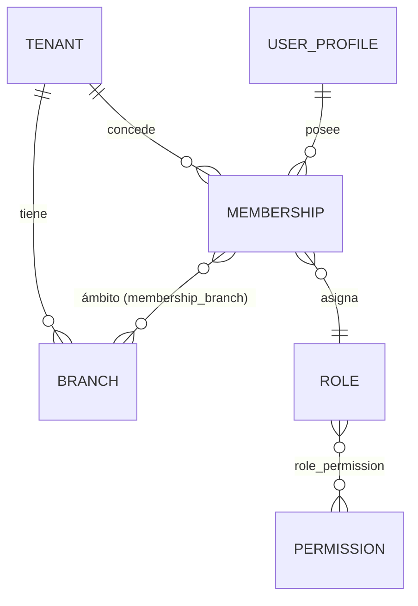
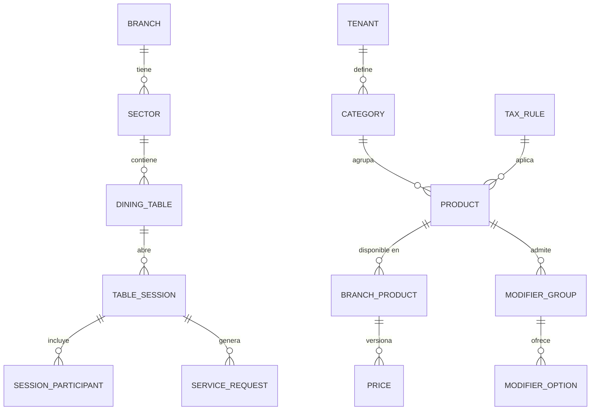
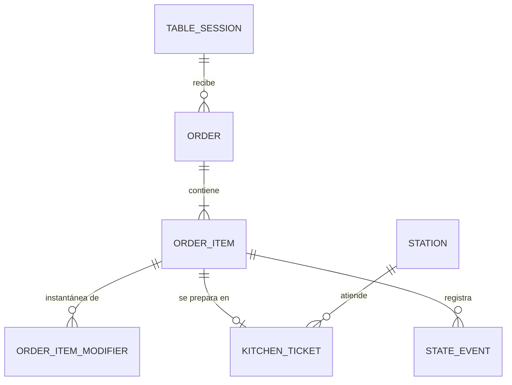
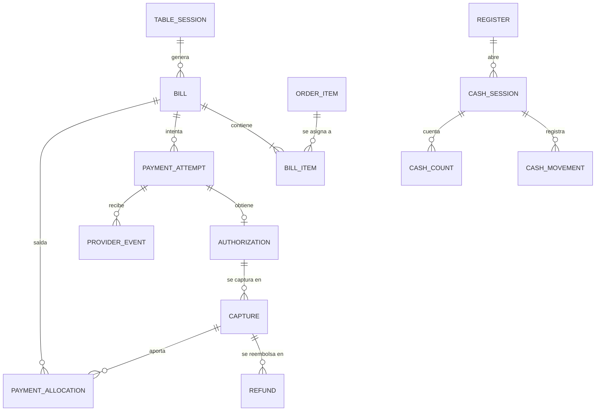
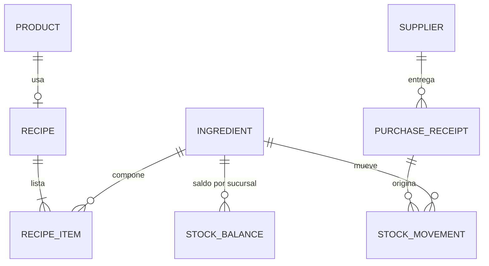

# Modelo de datos — ERD y diccionario

Estado: **«Organización» implementado en la Fase 1** (`dataconnect/schema/schema.gql`); **«Salón», «Carta» y el resumen de pedido, en la Fase 2** (`salon.gql`, `carta.gql`, `pedido.gql`). El resto sigue siendo el diseño lógico de la Fase 0 y se fija al escribir el esquema en su fase.

**Implementado (Fase 2, bloque 1, 2026-11-14), con sus diferencias respecto al borrador:**

- **Salón:** `Sector`, `DiningTable` (`qrPublicId` aleatorio y único) y `TableSession`. El borrador preveía un índice único parcial para garantizar una sola sesión abierta por mesa; SQL Connect no lo ofrece, así que se usa `openTableId` único, que vale el id de la mesa mientras está abierta y `null` al cerrarla. Verificado: el segundo intento de abrir la misma mesa falla por unicidad. `SessionParticipant` guarda `authUid` (sesión anónima) y `expiresAt` en lugar de un token: no hay credencial propia que guardar (ADR-0011).
- **Carta:** `TaxRule` (siempre incluido, D-01b; sin campo `inclusive`), `Category`, `Product` (alérgenos declarados como lista), `ModifierGroup`, `ModifierOption` (precio adicional por empresa), `ProductBranch` (disponibilidad y horario con `daysMask` y minutos locales) y `Price` (historial). `ProductBranch.currentPrice` apunta a la versión vigente para que la carta se lea en una consulta; se actualiza en la misma transacción que inserta el precio nuevo.
- **Pedido:** `OrderQuote` y `OrderQuoteLine` (resumen verificable con instantáneas), escritos solo por el backend. `IdempotencyRecord` se sustituye en esta fase por la unicidad `(participantId, idempotencyKey)` del resumen.
- Todas las relaciones usan FK compuestas con `tenantId` y, en lo operativo, `branchId`.

**Implementado (Fase 1):** `Tenant` (con `status` ACTIVE/SUSPENDED), `Branch`, `UserProfile` (solo `displayName`; sin correo, por minimización), `Role`, `Permission`, `RolePermission`, `Membership`, `MembershipBranch` (FK compuestas hacia `Membership` y `Branch` con `tenantId`) y `AuditEvent` (operación, recurso, actor y motivo; sin `before`/`after` todavía). Diferencias con el borrador: los roles son **solo de sistema** (clave `code`, sin `tenant_id`) hasta que haga falta personalizarlos; `version` en `Membership` se aplaza hasta que haya edición concurrente real; las empresas, sucursales y el catálogo de roles se crean por aprovisionamiento en el servidor, nunca desde la app.

## 1. Convenciones comunes

| Regla | Aplicación |
|---|---|
| Identificadores | `id uuid` no predecible en recursos expuestos; aun así se comprueban permisos |
| Ámbito | Toda entidad de negocio lleva `tenant_id`; las operativas, también `branch_id` |
| Integridad entre empresas | Claves foráneas **compuestas** `(tenant_id, id)` o `(tenant_id, branch_id, id)` para impedir vínculos cruzados |
| Unicidad | Restricciones únicas incluyen el ámbito (p. ej. `UNIQUE (tenant_id, branch_id, code)`) |
| Dinero | `*_minor bigint` + `currency char(3)` (ADR-0005) |
| Tiempo | `timestamptz` asignado por el servidor (UTC) |
| Concurrencia | `version integer` en entidades editables concurrentemente (cuenta, mesa, sesión, stock) |
| Auditoría | `created_at`, `created_by`, `updated_at`, `updated_by` |
| Borrado | Ventas, cobros y movimientos nunca se borran; catálogo se archiva (`archived_at`) |
| Índices | Sobre consultas reales: `(tenant_id, branch_id, status, created_at)` como patrón base |

## 2. ERD por grupos

### Organización

### Salón y carta

### Operación

### Cuenta, pagos y caja

### Inventario y control

`AUDIT_EVENT`, `IDEMPOTENCY_RECORD` y `OUTBOX_EVENT` son transversales y referencian cualquier recurso por `(resource_type, resource_id)`.

## 3. Diccionario (campos clave)

Se omiten las columnas comunes de la sección 1 salvo cuando aportan.

### Organización

| Entidad | Campos clave | Restricciones / notas |
|---|---|---|
| Tenant | `id`, `name`, `status`, `default_currency`, `default_timezone` | Límite de aislamiento |
| Branch | `tenant_id`, `id`, `name`, `currency`, `timezone`, `prices_include_tax`, `rounding_rule`, `status` | Parámetros por sucursal (D-01) |
| UserProfile | `id` (= uid de Firebase Auth), `display_name`, `email` | Datos personales mínimos (D-10) |
| Membership | `tenant_id`, `user_id`, `role_id`, `status`, `revoked_at`, `version` | `UNIQUE (tenant_id, user_id)`; revocación efectiva en servidor |
| MembershipBranch | `tenant_id`, `membership_id`, `branch_id` | Ámbito de sucursales asignadas |
| Role | `tenant_id` (nulo para roles de sistema), `code`, `rank` | `rank` impide invitar a un rol superior |
| Permission | `code` (p. ej. `bill.refund`) | Catálogo fijo versionado en código |

### Salón

| Entidad | Campos clave | Restricciones / notas |
|---|---|---|
| Sector | `tenant_id`, `branch_id`, `name`, `sort` | |
| DiningTable | `tenant_id`, `branch_id`, `sector_id`, `code`, `seats`, `qr_public_id`, `version` | `UNIQUE (tenant_id, branch_id, code)` |
| TableSession | `tenant_id`, `branch_id`, `table_id`, `status`, `opened_at`, `closed_at`, `version` | Máximo una sesión abierta por mesa (índice único parcial) |
| SessionParticipant | `session_id`, `kind` (cliente/mesero), `auth_uid`, `token_hash`, `expires_at` | Credencial de alcance reducido; nunca se guarda el token en claro |
| ServiceRequest | `session_id`, `type`, `status`, `handled_by` | |

### Carta

| Entidad | Campos clave | Restricciones / notas |
|---|---|---|
| Category | `tenant_id`, `name`, `sort`, `archived_at` | |
| Product | `tenant_id`, `category_id`, `name`, `description`, `allergens_declared`, `tax_rule_id`, `archived_at` | Alérgenos como información declarada |
| BranchProduct | `tenant_id`, `branch_id`, `product_id`, `available`, `schedule` | Disponibilidad por sucursal |
| Price | `branch_product_id`, `amount_minor`, `currency`, `valid_from`, `version` | Historial; el pedido referencia la versión |
| ModifierGroup | `product_id`, `min`, `max`, `required` | `CHECK (min <= max)` |
| ModifierOption | `group_id`, `name`, `price_delta_minor` | |
| TaxRule | `tenant_id`, `code`, `rate_bp` (puntos básicos), `inclusive` | Depende de D-01 |

### Operación

| Entidad | Campos clave | Restricciones / notas |
|---|---|---|
| Order | `tenant_id`, `branch_id`, `session_id`, `status` (derivado), `idempotency_key`, `submitted_by`, `submitted_at` | `UNIQUE (tenant_id, idempotency_key)` |
| OrderItem | `order_id`, `product_name_snapshot`, `unit_price_minor`, `quantity`, `tax_snapshot`, `station_id`, `status`, `version` | `CHECK (quantity > 0)`; instantánea inmutable |
| OrderItemModifier | `order_item_id`, `name_snapshot`, `price_delta_minor` | Instantánea |
| Station | `tenant_id`, `branch_id`, `name` | |
| KitchenTicket | `order_item_id`, `station_id`, `priority` | |
| StateEvent | `resource_type`, `resource_id`, `from`, `to`, `actor`, `reason`, `at` | Historial de transiciones |

### Cuenta, pagos y caja

| Entidad | Campos clave | Restricciones / notas |
|---|---|---|
| Bill | `tenant_id`, `branch_id`, `session_id`, `currency`, `status`, `subtotal_minor`, `tax_minor`, `discount_minor`, `tip_minor`, `total_minor`, `version` | Moneda única por cuenta |
| BillItem | `bill_id`, `order_item_id`, `amount_minor` | Una línea no se asigna dos veces por encima de su importe |
| PaymentAttempt | `tenant_id`, `bill_id`, `idempotency_key`, `amount_minor`, `currency`, `status`, `consent_text_version` | Ver `state-machines.md` |
| Authorization | `attempt_id`, `provider_ref`, `authorized_minor`, `expires_at` | |
| Capture | `authorization_id`, `provider_ref`, `amount_minor`, `status` | Σ capturas ≤ autorizado vigente |
| Refund | `capture_id`, `provider_ref`, `amount_minor`, `status`, `reason`, `requested_by` | Σ reembolsos confirmados ≤ capturado |
| PaymentAllocation | `bill_id`, `source` (captura/efectivo/otro), `amount_minor` | Σ asignaciones = total exacto al cerrar |
| ProviderEvent | `provider`, `external_event_id`, `payload_hash`, `received_at`, `processed_at` | `UNIQUE (provider, external_event_id)` (deduplicación) |
| Register | `tenant_id`, `branch_id`, `name` | |
| CashSession | `register_id`, `opened_by`, `opening_float_minor`, `status`, `closed_at` | Una abierta por caja |
| CashMovement | `cash_session_id`, `kind`, `amount_minor`, `reason` | |
| CashCount | `cash_session_id`, `expected_minor`, `counted_minor`, `difference_minor`, `reason` | |

### Inventario

| Entidad | Campos clave | Restricciones / notas |
|---|---|---|
| Ingredient | `tenant_id`, `name`, `base_unit` | |
| Recipe / RecipeItem | `product_id`; `ingredient_id`, `quantity`, `unit` | Conversiones de unidad definidas |
| StockMovement | `tenant_id`, `branch_id`, `ingredient_id`, `kind`, `quantity`, `source_ref` | `UNIQUE (source_ref, ingredient_id, kind)` evita doble descuento |
| StockBalance | `tenant_id`, `branch_id`, `ingredient_id`, `quantity`, `version` | Política de stock negativo pendiente |
| Supplier / PurchaseReceipt | `tenant_id`; `supplier_id`, `branch_id`, `received_at` | |

### Control

| Entidad | Campos clave | Restricciones / notas |
|---|---|---|
| AuditEvent | `tenant_id`, `actor`, `resource_type`, `resource_id`, `operation`, `reason`, `before`, `after`, `at`, `correlation_id` | Solo inserción para roles de negocio |
| IdempotencyRecord | `tenant_id`, `key`, `operation`, `request_hash`, `response`, `expires_at` | `UNIQUE (tenant_id, key)` |
| OutboxEvent | `tenant_id`, `type`, `payload`, `status`, `attempts`, `next_attempt_at` | Entrega fiable hacia pasarela/FCM |

## 4. Pendiente de definir

- Política de stock negativo y concurrencia de la última unidad (Fase 5).
- Retención y anonimización de datos personales (D-10).
- Representación de impuestos compuestos según país (D-01).
- Mapeo exacto a tipos y directivas de SQL Connect (tras el spike, D-13).
