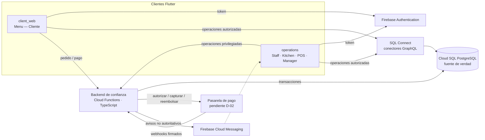
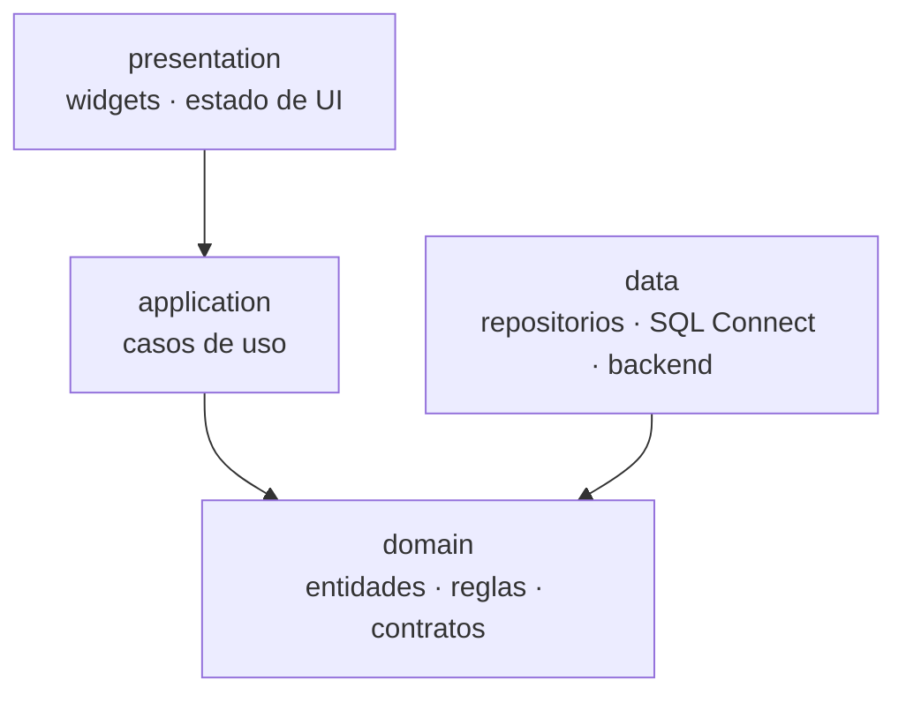

# Arquitectura — visión general

Estado: **propuesta de Fase 0**. Las piezas marcadas como *pendiente* dependen de una decisión del propietario o del spike de SQL Connect (D-13).

## 1. Vista de contexto



Principios:

- **PostgreSQL es la fuente de verdad.** FCM solo avisa; al recibir un aviso, el cliente consulta el estado real.
- **Flutter nunca habla con PostgreSQL ni con la pasarela directamente.** Solo con SQL Connect (operaciones con autorización declarada) o con el backend.
- **El backend ejecuta lo que el conector no puede garantizar**: pagos, webhooks, conciliación, operaciones con invariantes transaccionales y tareas programadas.

## 2. Estructura del repositorio (ADR-0001, aceptada)

```text
Tavelyo/
  CLAUDE.md
  docs/                       # Requisitos, arquitectura, decisiones, marca, pruebas, planes y progreso
  apps/
    client_web/               # Menu — Cliente (ADR-0002)
    operations/               # Staff, Kitchen, POS y Manager por rol (ADR-0002)
  packages/
    core/                     # Errores, Money, fechas, resultados, contratos compartidos
    design_system/            # Tokens, tema y componentes
    features/
      identity/  tenancy/  catalog/  tables/  orders/
      kitchen/   billing/  payments/ inventory/ reporting/
  dataconnect/                # Esquema, conectores y SDK generado (directorio por defecto de la CLI)
  backend/                    # Backend de confianza (ADR-0003)
  assets/branding/            # Solo recursos maestros aprobados (vacío hasta D-12)
```

Los paquetes se crean **cuando una fase los necesita**, no por formalismo. Fase 1 crearía `core`, `design_system`, `identity` y `tenancy`.

## 3. Capas dentro de cada módulo



- `domain` es Dart puro: sin Flutter, Firebase ni SDK de pagos.
- `data` implementa los contratos de `domain`. El SDK generado de SQL Connect solo se importa en `data`.
- Los módulos se comunican mediante contratos públicos, nunca importando internos de otro módulo.
- La inyección de dependencias se resuelve en cada app (composición en el arranque).

## 4. Responsabilidades por componente

| Componente | Hace | No hace |
|---|---|---|
| Apps Flutter | Presentación, validación de entrada, caché de lectura, borradores | Cálculo financiero autoritativo, autorización, estados finales de pago |
| SQL Connect | Lecturas y escrituras simples con `@auth` y filtros por membresía | Invariantes multi-tabla que no pueda garantizar (por verificar en spike) |
| Backend | Pedidos con revalidación de precios, pagos, webhooks, conciliación, inventario, auditoría, outbox | Lógica de presentación |
| PostgreSQL | Datos, restricciones, claves compuestas, transacciones | — |
| FCM | Avisos de cambios | Registro de pedidos o pagos |

## 5. Transversales

- **Errores**: tipo `Result`/fallas de dominio en `core`; mensajes de usuario localizados, sin códigos internos como única explicación.
- **Localización**: español inicial (SUP-01) con formato de importes, fechas y plurales configurable por sucursal.
- **Tiempo**: el servidor asigna marcas UTC; el cliente nunca ordena eventos críticos con su reloj.
- **Dinero**: objeto de valor `Money` (ADR-0005).
- **Telemetría**: sin tokens, tarjetas ni datos personales innecesarios en logs.

## 6. Documentos relacionados

- Modelo de datos: [`data-model.md`](data-model.md)
- Permisos: [`permissions.md`](permissions.md)
- Amenazas: [`threat-model.md`](threat-model.md)
- Estados y flujos: [`state-machines.md`](state-machines.md)
- Decisiones: [`../decisions/`](../decisions/)
