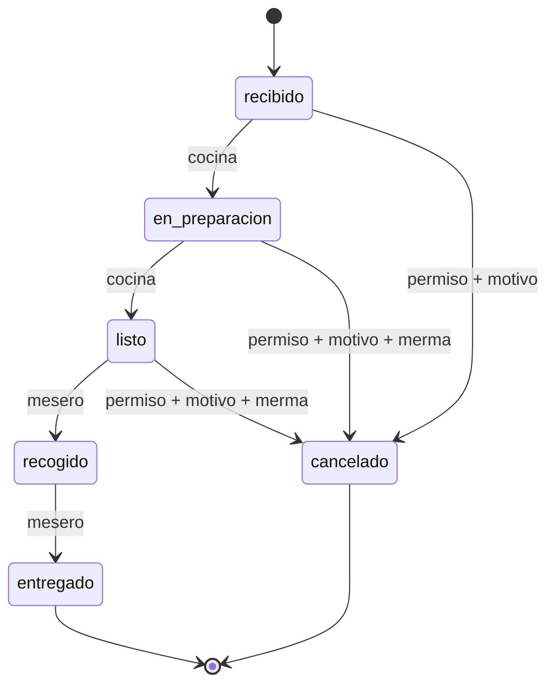
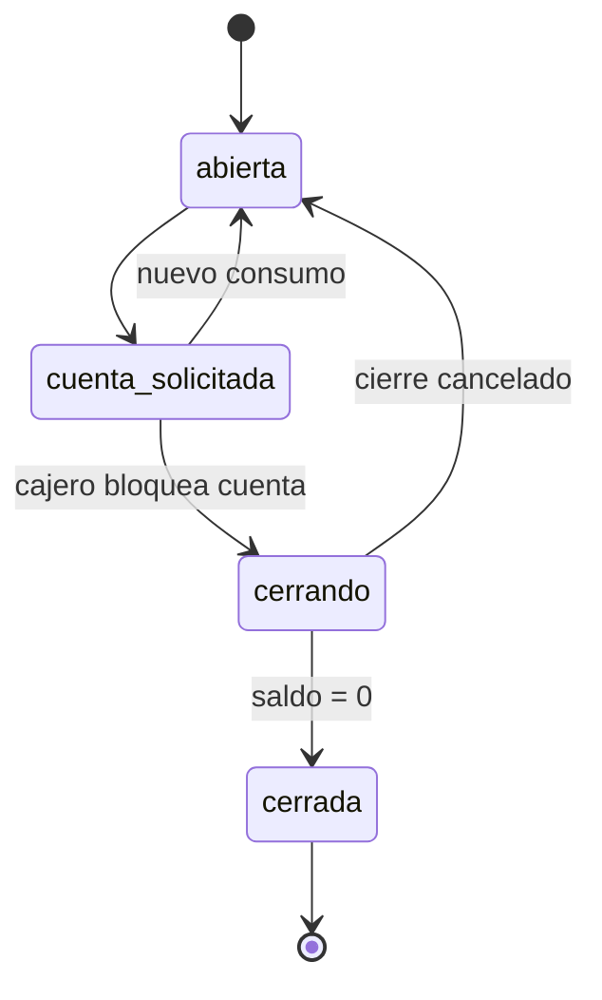
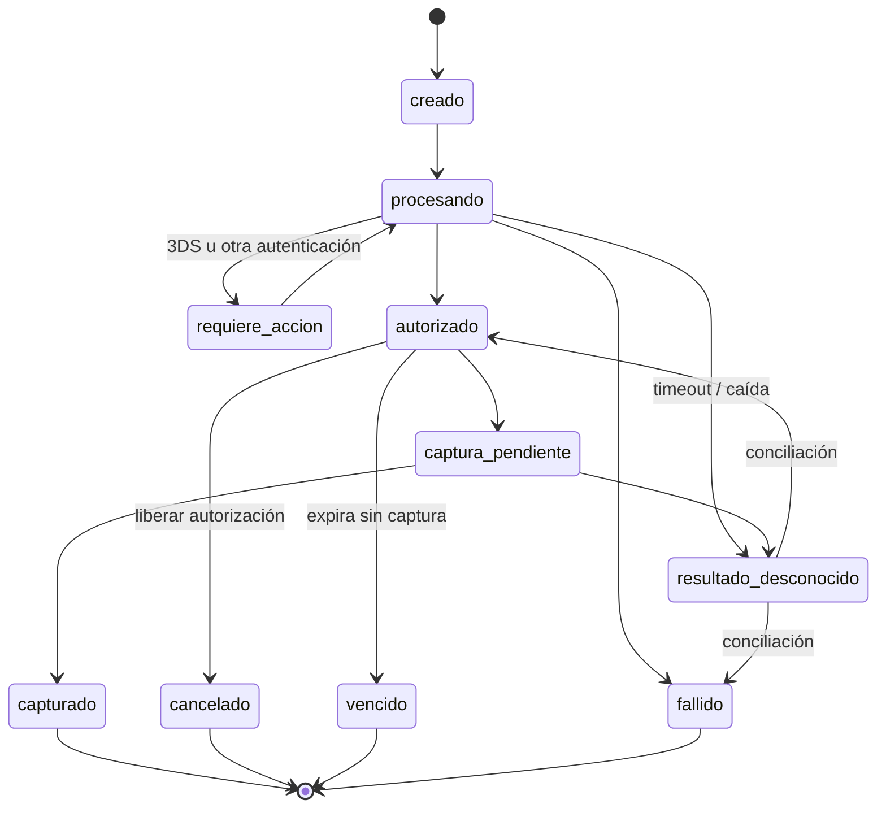
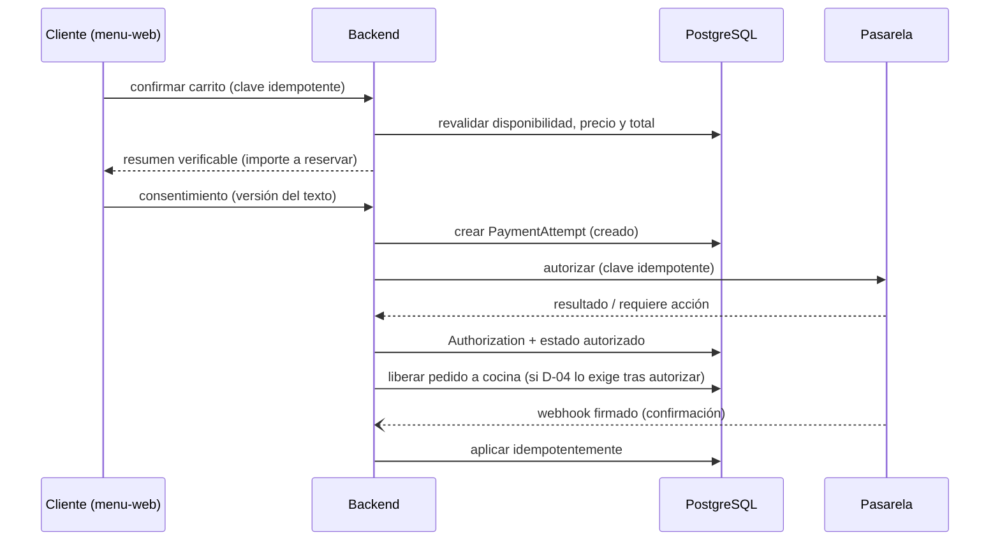

# Máquinas de estado y flujos críticos

Estado: **borrador de Fase 0**. Los estados financieros, de pedido, de cocina y de sesión son **independientes** (PM §8). Toda transición la ejecuta el servidor, queda en `StateEvent` y rechaza transiciones inválidas.

## 1. Línea de pedido (OrderItem)

- Saltar `recogido` exige `delivery.skip_sequence` y queda auditado.
- Retroceder (p. ej. `en_preparacion → recibido`) **no está permitido** (D-26, 2026-11-16): un error se corrige cancelando la línea con motivo.
- **Estado de la orden (derivado):** `recibido` si todas sus líneas activas lo están; `parcialmente_listo` si alguna está `listo` y otras no; `listo` cuando todas las activas lo están; `entregado` cuando todas se entregaron.

**Implementación (Fase 3, bloque 1):** `packages/core/src/order-status.ts`, con los códigos del enum `OrderItemStatus` del esquema.

| Acción | Desde | Hacia | Quién | Motivo |
|---|---|---|---|---|
| `start` | `RECEIVED` | `IN_PREPARATION` | Cocina (`kitchen.advance`) | No |
| `finish` | `IN_PREPARATION` | `READY` | Cocina (`kitchen.advance`) | No |
| `pickUp` | `READY` | `PICKED_UP` | Mesero (`delivery.pickup`) | No |
| `deliver` | `PICKED_UP` | `DELIVERED` | Mesero (`delivery.deliver`) | No |
| `deliverDirectly` | `READY` | `DELIVERED` | `delivery.skip_sequence` | Sí |
| `cancel` | `RECEIVED`, `IN_PREPARATION`, `READY` | `CANCELLED` | `order_item.cancel` | Sí; merma si ya se empezó |

- Estado derivado del pedido: `RECEIVED`, `IN_PREPARATION` (alguna empezó y ninguna salió de cocina), `PARTIALLY_READY` (unas salieron de cocina y otras no), `READY` (todas salieron de cocina y falta entregar alguna), `DELIVERED` y `CANCELLED` (sin líneas activas). Una línea «salió de cocina» si está lista, recogida o entregada.
- Los permisos los comprueban los conectores (bloque 2); `core` solo decide si la transición existe. Cada cambio se aplica en el servidor solo si el estado y la `version` siguen siendo los que vio quien lo pide (caso 4).

## 2. Sesión de mesa (TableSession)

Al cerrar, se invalidan las credenciales de los participantes; el QR de la mesa abre una sesión nueva.

## 3. Intento de pago (PaymentAttempt)

- `resultado_desconocido` **nunca** dispara un nuevo cobro: se consulta o se reintenta la misma operación idempotente.
- Los estados confirmados no retroceden ante webhooks tardíos.
- El mapeo a los estados de la pasarela se documenta tras D-02.
- **Implementación (Fase 4, bloque 1):** el diagrama se reparte en dos tablas. `PaymentOperation` guarda cada llamada a la pasarela (`CREATED` → `PROCESSING` → `SUCCEEDED` | `FAILED` | `UNKNOWN`); `UNKNOWN` es `resultado_desconocido` y la conciliación lo resuelve con la misma clave. `PaymentAuthorization` guarda el estado de la preautorización (`AUTHORIZED` → `CAPTURED` | `VOIDED` | `EXPIRED`); `requiere_accion` (3DS) llega con la pasarela real.
- **Implementación (Fase 4, bloque 3):** las mutaciones que cierran una operación (`pagos.gql`) solo avanzan desde `CREATED`, `PROCESSING` o `UNKNOWN` y aplican sus efectos (pago, autorización, reembolso) en la misma transacción y una sola vez: un aviso tardío o repetido no retrocede nada. Un reembolso en curso deja la operación en `PROCESSING` hasta el aviso o la consulta. La conciliación (`backend/src/payments/reconcile-payments.ts`) resuelve `UNKNOWN` consultando con la misma clave o repitiendo la misma operación.

## 4. Reembolso (Refund)

`solicitado → procesando → confirmado | rechazado | resultado_desconocido`. La interfaz no lo muestra completado hasta `confirmado`. En el esquema: `RefundStatus` (`REQUESTED`, `PROCESSING`, `CONFIRMED`, `REJECTED`, `UNKNOWN`).

## 5. Sesión de caja (CashSession)

`abierta → en_cierre (conteo) → cerrada`. Una diferencia distinta de cero exige motivo. En el esquema, `CashSessionStatus` es `OPEN` o `CLOSED`: el conteo (`CashCount`) y el cierre se guardan en la misma transacción, así que no hace falta un estado intermedio.

## 6. Flujo crítico: pedido con preautorización

D-04 (2026-11-16): la garantía es obligatoria y sin excepciones; el pedido se libera a cocina solo después de la autorización confirmada.

## 7. Flujo crítico: cierre y captura

1. El cajero bloquea la cuenta (`version`); se recalcula el saldo.
2. Se captura solo el importe final permitido por la autorización vigente.
3. La confirmación llega por webhook verificado o consulta autenticada.
4. Se registran `Capture` y `PaymentAllocation`; si Σ asignaciones = total, la sesión pasa a `cerrada`.
5. Las autorizaciones sobrantes se liberan según las capacidades de la pasarela.
