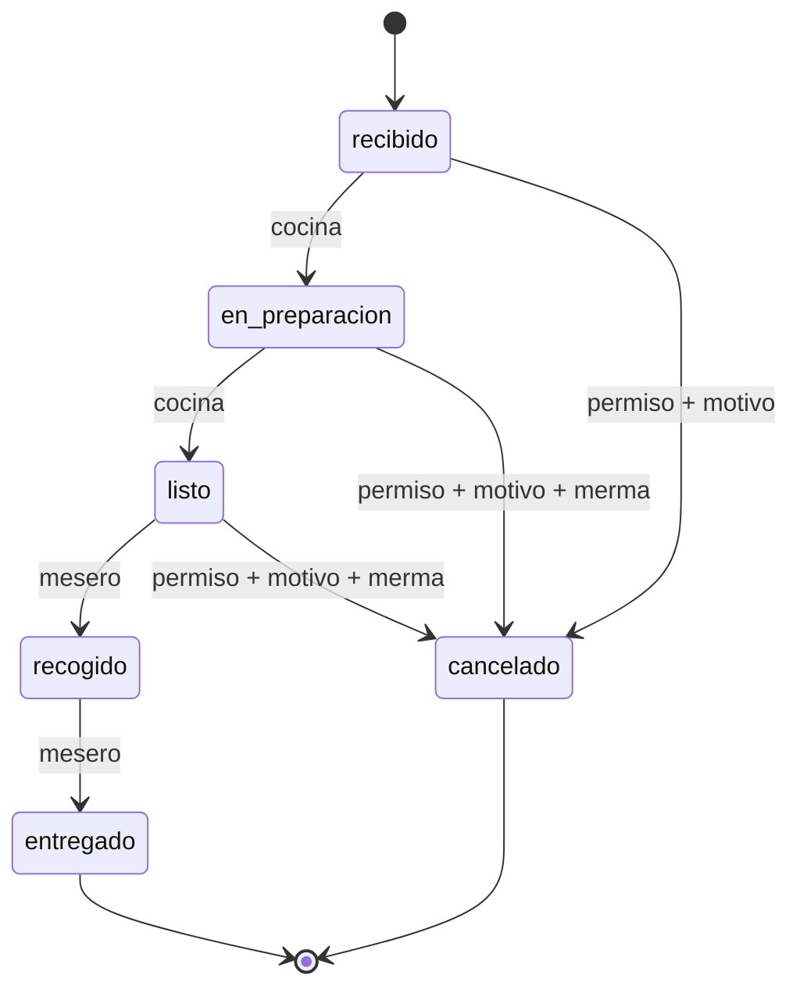
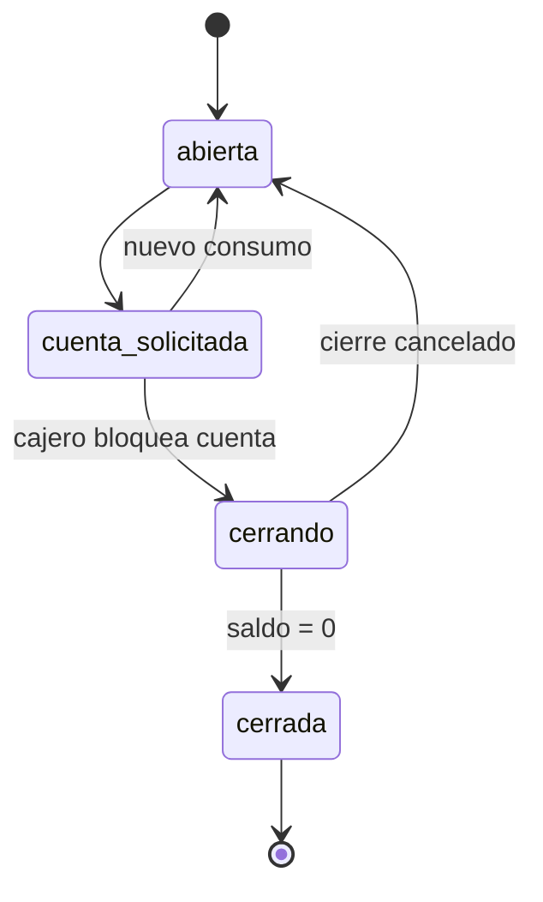
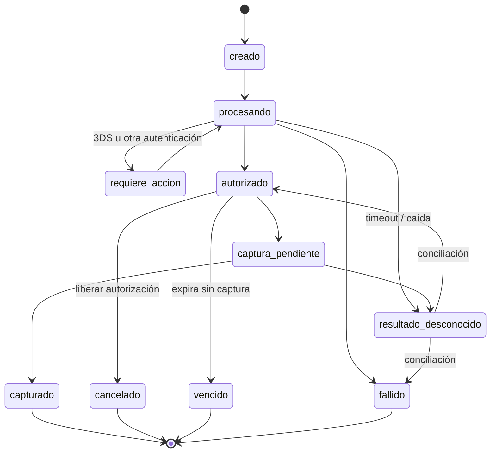
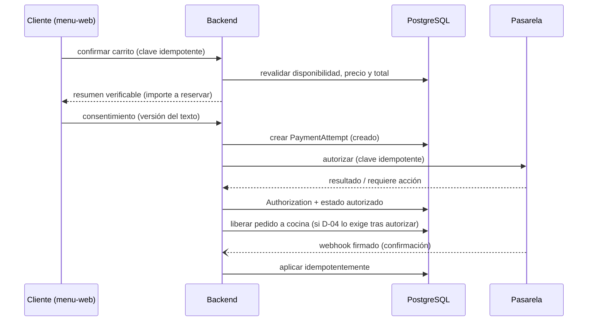

# Máquinas de estado y flujos críticos

Estado: **borrador de Fase 0**. Los estados financieros, de pedido, de cocina y de sesión son **independientes** (PM §8). Toda transición la ejecuta el servidor, queda en `StateEvent` y rechaza transiciones inválidas.

## 1. Línea de pedido (OrderItem)

- Saltar `recogido` exige `delivery.skip_sequence` y queda auditado.
- Retroceder (p. ej. `en_preparacion → recibido`) no está permitido salvo como excepción auditada; pendiente de decidir si se admite.
- **Estado de la orden (derivado):** `recibido` si todas sus líneas activas lo están; `parcialmente_listo` si alguna está `listo` y otras no; `listo` cuando todas las activas lo están; `entregado` cuando todas se entregaron.

## 2. Sesión de mesa (TableSession)

Al cerrar, se invalidan las credenciales de los participantes; el QR de la mesa abre una sesión nueva.

## 3. Intento de pago (PaymentAttempt)

- `resultado_desconocido` **nunca** dispara un nuevo cobro: se consulta o se reintenta la misma operación idempotente.
- Los estados confirmados no retroceden ante webhooks tardíos.
- El mapeo a los estados de la pasarela se documenta tras D-02.

## 4. Reembolso (Refund)

`solicitado → procesando → confirmado | rechazado | resultado_desconocido`. La interfaz no lo muestra completado hasta `confirmado`.

## 5. Sesión de caja (CashSession)

`abierta → en_cierre (conteo) → cerrada`. Una diferencia distinta de cero exige motivo.

## 6. Flujo crítico: pedido con preautorización

Pendiente de D-04: si la garantía no es obligatoria, el pedido se libera a cocina sin esperar la autorización.

## 7. Flujo crítico: cierre y captura

1. El cajero bloquea la cuenta (`version`); se recalcula el saldo.
2. Se captura solo el importe final permitido por la autorización vigente.
3. La confirmación llega por webhook verificado o consulta autenticada.
4. Se registran `Capture` y `PaymentAllocation`; si Σ asignaciones = total, la sesión pasa a `cerrada`.
5. Las autorizaciones sobrantes se liberan según las capacidades de la pasarela.
